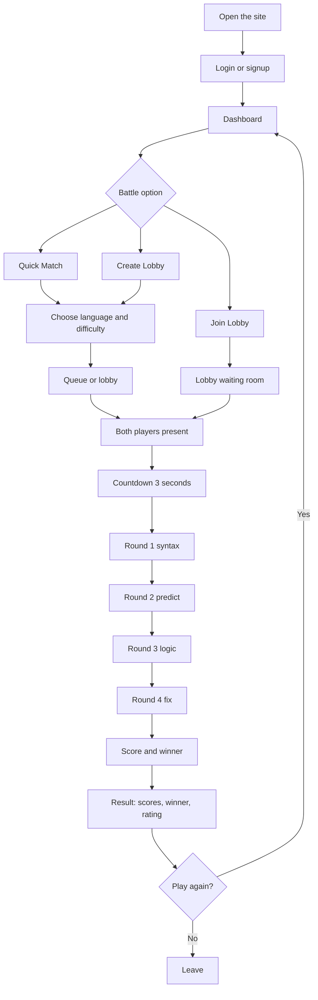

# Product

## One sentence

CodeArena pairs two players and runs them through the same four short coding rounds, then shows the score, the winner, and the rating change.

## What it is taking from Matiks

Matiks makes practice feel like a match: a real opponent, a clock, a rating, a leaderboard, and another match a few seconds later. CodeArena uses that shape for programming.

These Matiks ideas are in v1 because the deck already requires them:

- Live 1v1, not a solo worksheet.
- A short session made of several rounds, not one long problem.
- Rating that moves after a ranked match, shown on the result screen.
- A dashboard that leads straight back into another battle.
- A private way to play a specific person (Create Lobby / Join Lobby) and a public way to find a stranger (Quick Match).

These Matiks ideas are not in v1. They are listed so nobody builds them “because Matiks has them”:

- Daily puzzle and streak rewards.
- A friend graph, chat, or spectator mode.
- Memory or puzzle modes that are not the four coding rounds.
- Seasonal leagues, tournaments, and achievement badges. The future-work slide names leagues, tournaments, seasons, streaks, achievements, practice mode, and recommendations. They stay out of this build.
- Cash, ads, or a store.

## The only match

There is one match format. A match is always these four rounds, in this order, played by both players at the same time:

| Round | Title | What the player does | How it is graded |
| --- | --- | --- | --- |
| 1 | Find Syntax Error | Edits the broken program | Compile, then sample and hidden tests |
| 2 | Predict Output | Picks one of four answers | Exact option id, no sandbox |
| 3 | Find Logical Error | Picks one of four descriptions of the bug | Exact option id, no sandbox |
| 4 | Fix the Code | Edits the program until the tests pass | Compile, then sample and hidden tests |

The methodology slide’s “write, test, and submit” step is round 1 and round 4. It is not a separate fifth mode where a player writes a program from a blank LeetCode-style prompt. That mode is out of scope.

## How a session moves

This is the slide 9 flowchart, with the states the server actually stores.

A 5 second intermission sits between rounds so both players can see the round score and, for rounds 2 and 3, the right answer. The flowchart does not draw that pause. It is required for the screen to be understandable. The clock for the next round does not start during the intermission.

“Play again” returns to the dashboard, as the arrow in the flowchart does. The result screen also offers Rematch, which opens an unrated lobby and invites the opponent. Rematch is the methodology slide’s rematch option. It does not change rating.

## Battle options

### Quick Match

1. The player chooses a language and a difficulty.
2. They enter a queue with other players who chose the same language and difficulty.
3. The matcher pairs ratings that are close enough for how long each player has waited. The windows are in `contracts/constants.json`.
4. The server picks four published problems, one per round, avoiding problems either player has seen in their last 20 matches when the bank allows it.
5. Both clients show “Both players ready” and a 3 second countdown. There is no extra Ready button. A second click is a stall the flowchart does not ask for.
6. The match is rated, unless the same two accounts have already played 3 rated matches against each other in the last 24 hours. The 4th and later matches in that window still happen, and they are unrated. This stops two friends from farming Quick Match.

A player at 1600 or above cannot enter the rated Easy queue. A player at 2000 or above cannot enter the rated Easy or Medium queue. They can still play those difficulties in a lobby. The caps exist because one global rating plus a self-selected Easy queue would let a strong player farm beginners. The deck does not state the cap numbers. They are a decision, recorded in `02-decisions.md`.

### Create Lobby and Join Lobby

1. The host chooses language and difficulty and receives a 6 character code.
2. The code alphabet omits `0`, `O`, `1`, and `I`.
3. The lobby dies after 30 minutes if a second player has not joined.
4. The joiner sees the host’s language and difficulty and cannot change them. A syntax error in Python is not a fair problem for a C lobby.
5. When the second account joins, the 3 second countdown starts by itself. Either player may leave during the countdown. The other returns to an open lobby and can wait for someone else. The host leaving cancels the lobby.
6. Lobby matches are always unrated. There is no “ranked private room” switch in v1.

## Dashboard

The flowchart requires a home after login. v1 dashboard shows:

- The player’s rating, wins, losses, draws, and matches played.
- Quick Match, Create Lobby, and Join Lobby.
- The last five matches, each linking to its result.
- The top five of the global leaderboard, linking to the full board.
- The player’s username and Log out.

It does not show streaks, recommended problems, or charts. Those are on the future-work slide.

## Result screen

- Winner, or an explicit draw.
- A four-row table: round title, your score, opponent score, your time, your verdict.
- Rating before, rating after, and the signed delta. An unrated match shows “Unrated” and does not display a fake delta.
- After the match is final, each player may open their own submissions and the opponent’s best submission for rounds 1 and 4, and both chosen options for rounds 2 and 3, plus the explanation.
- Back to dashboard. Rematch.

## Accounts and public pages

- Sign up with email, username, display name, and password.
- Username matches `^[a-z0-9_]{3,20}$`, is stored lowercase, and is immutable in v1.
- A public profile at `/players/{username}` shows rating, record, and recent matches. It does not show email.
- A leaderboard shows the top 100 by rating, then wins, then username.
- History shows the caller’s own matches, newest first, 20 per page.

## Problem bank

Problems are written by the team or by a faculty setter. They are original. Do not import statements or tests from LeetCode, HackerRank, Codeforces, GeeksforGeeks, or any other site.

A problem belongs to one language and one round type. The same idea in C and in Python is two rows, because the starter code and the syntax are not interchangeable.

Choice rounds have exactly four options, exactly one of them correct, and the same order for both players. Code rounds have 1 to 3 sample tests and at least 3 hidden tests.

The setter tool is part of v1. Without it the bank cannot be loaded safely. It is an internal form, not a public product surface. Bulk load accepts the JSON shape in `contracts/problem-pack.example.json`.

## Fairness the player can see

- The timer on screen is a render of the server timestamp `endsAt`. The client measures its offset from `serverTime` and never sends “my timer hit zero” as a fact.
- Submission time is the time the server received the request, not the time the container finished. A busy judge does not tax the player.
- A submission that arrived before `endsAt` is graded. The round waits up to 30 seconds for that grade before it closes. A grade that arrives after the grace period is stored and does not change the score.
- Disconnects do not pause the clock. The player has 30 seconds to reconnect after the server marks the socket dead, and then the match continues with them absent. Forfeit rules are in the match engine.

## Winner, in one paragraph

Each round is worth up to 100. A wrong or missing answer is 0. A correct answer scores from 30 to 100 based on how fast it arrived, and each earlier wrong code submission on that round subtracts 10, down to a floor of 1. The higher total wins. Equal totals go to the player with the smaller sum of times on rounds they got right. If that is also equal, the match is a draw. The formula, the rounding rule, and a fully worked numeric example are in `04-match-engine.md`.

## Players, setters, admins

| Role | Can |
| --- | --- |
| `player` | Play, view public profiles, view own submissions |
| `setter` | Everything a player can do, plus create and edit problems and import a pack |
| `admin` | Everything a setter can do, plus change a user’s role |

The first admin is created from environment variables on an empty database, then those variables are removed. Details are in `12-infrastructure.md`.

## Non-goals

- More than two players in a match.
- Spectators.
- A player choosing a different language from their opponent.
- Partial credit on choice rounds.
- Floating-point tolerances. Do not author numeric-output problems that depend on rounding.
- Chat, forums, or code sharing inside the match.
- Running student code on the API process, on the web server, or in the browser as the official grade. The browser may syntax-highlight. It may not judge.
- Mobile apps and a command-line client. The API must not grow a web-only shortcut that would block them later. Building those clients is future work.
