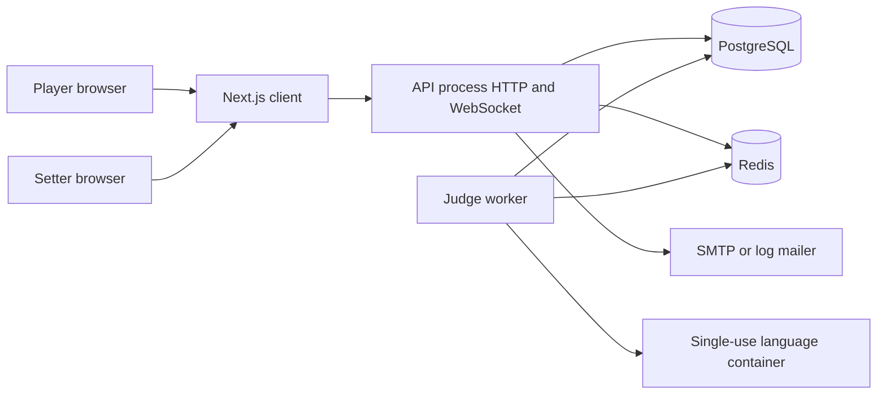

# Architecture

## Context



The browser talks only to the API origin and loads the web origin. It never talks to PostgreSQL, Redis, or Docker. The worker is the only process whose network namespace is allowed to create containers. The container that runs student code has no network at all.

## Trust zones

| Zone | Runs | May reach | Holds |
| --- | --- | --- | --- |
| Edge | Caddy | Web and API | TLS certificates |
| App | `web`, `api` | PostgreSQL, Redis, SMTP | User passwords in transit, access tokens in memory on the client |
| Data | PostgreSQL, Redis | Nothing public | Accounts, problems including hidden tests and correct options, ratings |
| Execution | `worker`, then a container | Docker socket from the worker only. The container reaches nothing. | One submission’s source, mounted read-only |

The Docker socket is root-equivalent on the host. Only the worker’s user can touch it. The API container must not mount `/var/run/docker.sock`.

## Processes

### `web`

Next.js standalone server. Renders pages and ships the arena client. It does not call the database. It does not embed secrets. Anything prefixed `NEXT_PUBLIC_` is visible to every visitor, so that prefix is only for the API base URL and the WebSocket base URL.

### `api`

NestJS HTTP server plus a WebSocket server on the same port. Stateless. Two replicas are allowed. Anything that must happen exactly once per match (pairing, opening a round, writing a rating) takes a PostgreSQL row lock or a Redis lock, so the second replica no-ops.

Responsibilities:

- Auth, profiles, leaderboard, history.
- Problem CRUD for setters.
- Queue join and leave, lobby create and join and leave.
- Match snapshot reads.
- Accepting submissions and enqueueing judge jobs.
- Issuing single-use WebSocket tickets.
- Pushing events that it originated (queue position, lobby membership, match snapshot on join).

The API does not compile or execute student code.

### `worker`

A separate Node process from the same backend repository. It does not serve player traffic.

Responsibilities:

- Matchmaking tick, once per second, under a Redis lock so two workers do not double-pair.
- Delayed timers: countdown end, round end, intermission end, lobby expiry, disconnect forfeit.
- Judge jobs: compile and run inside a fresh container, compare output, write the verdict.
- Reconcile loop every 10 seconds: requeue a `queued` or `running` submission older than 15 seconds whose job is gone, and close a round whose `ends_at` has passed and whose grace has passed if the timer job was lost.

One worker is enough for the VPS. A second worker is safe because jobs are locked by BullMQ and match transitions lock the `matches` row with `SELECT … FOR UPDATE`.

## Why this split and not microservices

Auth, matches, and ratings share one transaction. Splitting them into services would put the rating write on the other side of a network call and create a class of “match saved, rating not saved” bugs. The only split that earns its cost is the judge: it needs the Docker socket, it runs untrusted CPU, and it must be killable.

Modules inside `api` are still hard boundaries. `MatchesModule` is the only writer of `matches`, `match_rounds`, `round_scores`, and `rating_events`. Other modules call it. They do not inject its repository.

## Synchronous path and asynchronous path

A graded code submission:

```mermaid
sequenceDiagram
  participant Browser
  participant API
  participant PG as PostgreSQL
  participant Redis
  participant Worker
  participant Box as Container
  Browser->>API: POST /matches/{id}/submissions
  API->>PG: insert submission status=queued
  API->>Redis: BullMQ job judge
  API-->>Browser: 202 submissionId
  Worker->>Redis: claim job
  Worker->>PG: status=running
  Worker->>Box: compile and run, stdin is the test
  Box-->>Worker: stdout, stderr, exit, duration
  Worker->>Worker: compare outside the container
  Worker->>PG: verdict, maybe round score, lock match row
  Worker->>Redis: publish user:{userId}
  Redis-->>API: fan-out
  API-->>Browser: submission.result and opponent.progress
```

Choice submissions skip Redis and the worker. The API grades them in the request, inside the same transaction that stores the score, then publishes the events. The correct option is a column the API already has. Putting that comparison in the worker would only add latency.

## Source of truth

| Fact | Owner | Rebuild rule |
| --- | --- | --- |
| Account, password hash, rating, match, round, score, submission | PostgreSQL | Restore from backup |
| Live socket fan-out | Redis pub/sub | Clients reconnect and call `match.join`, which sends a snapshot from PostgreSQL |
| Queue membership | Redis sorted set plus a hash | If Redis is flushed, every queued client receives `queue.reset` and must join again. No rated match is created from memory. |
| Presence | Redis key with TTL | A missing key means disconnected |
| “Which problems this match is using” | `match_rounds.snapshot` | Copied at match creation. Later edits to `problems` do not change a started match. |
| Judge job | BullMQ, backed by Redis | The reconciler requeues from `submissions` where `status` is `queued` or `running` |

The snapshot JSON for a round stores everything the client will be shown and everything the grader needs: prompt, starter code, options without a correct flag, explanation, limits, and for the worker’s copy of the job the correct option id and the tests. The client projection drops `correctOptionId`, hidden tests, and `explanationMd` while the round is `active`. The explanation is included in the intermission payload.

Two copies of hidden tests exist on purpose. The `test_cases` table is the editable bank. The snapshot is the frozen copy. The worker grades against the snapshot, not against the live table.

## Locking rules

- Creating a match locks both user ids with `pg_advisory_xact_lock` in ascending uuid order, so two queue ticks cannot deadlock and cannot put one person in two matches.
- Advancing a round or writing a score locks `matches` with `SELECT … FOR UPDATE`.
- Applying a verdict locks the match, re-reads the round status, and only sets `round_scores` if the round is still `active` or is inside judge grace (`status` still `active` and `now() < ends_at + grace`).
- Rating updates lock both `users` rows in ascending id order, in the same transaction as the match becoming `final`.

## Idempotency

`POST /matches/{id}/submissions` requires the header `Idempotency-Key`. The key is unique per user, stored for 24 hours.

- Same key and same request hash returns the original response body and status.
- Same key and a different hash returns `409 IDEMPOTENCY_CONFLICT`.
- The client generates the key before the request and reuses it if the network times out. It must not generate a new key for a retry of the same click.

Timer jobs and “both players solved” can both try to close a round. The row lock makes the second transition a no-op. Jobs carry `matchId` and `roundIndex` and check the stored status before writing.

## Time

Every timestamp persisted or sent on the wire is ISO-8601 UTC. The client computes:

```text
offsetMs = serverTimeMs - Date.now()
remainingMs = endsAtMs - (Date.now() + offsetMs)
```

`serverTime` arrives on the WebSocket `hello` message and on every snapshot. The client refreshes the offset from those messages. It does not use a one-time offset for a whole match if a later snapshot disagrees by more than one second. It replaces the offset.

## Failure behavior

| Failure | Player-visible result | System behavior |
| --- | --- | --- |
| API process dies | Socket drops, client retries with a new ticket | The other replica, or the restarted process, serves a snapshot. The clock never lived only in the dead process. |
| Worker dies mid-container | “Judging” stays up | Reconciler on the new worker marks the old `running` row `queued` if it has no live container, and runs it again. Containers are named `ca-{submissionId}` so the new worker can `docker rm -f` a leftover. |
| Judge returns `internal_error` | The attempt is not charged | Quota is unchanged. The client may submit again. One automatic retry of the job happens first. |
| PostgreSQL is down | 503 on mutations, banner on the client | No scores are accepted. Do not queue them in the browser to replay later. |
| Redis is down | Queue and live updates pause | API readiness fails. Existing PostgreSQL state is unchanged. |
| Container exceeds the wall clock | Verdict `time_limit` | Worker `docker kill`s the name. A `timeout` binary inside the image is a second layer, not the one that is trusted alone. |

## Scale path, not the current deployment

The VPS runs one `api` and one `worker`. The shape above already allows:

- More `api` replicas behind Caddy, sticky not required.
- More `worker` replicas. Container hosts can move to a separate machine that runs only Docker and the worker, with no inbound ports, pulling jobs from Redis.
- Managed PostgreSQL and managed Redis, with the worker’s database role denied `UPDATE` on `users.password_hash` and denied `UPDATE` on `problems.correct_option_id`. The worker may update submissions, round scores, and, through a single `finalize_match` SQL function that is `SECURITY DEFINER`, the rating columns. That function is the only rating writer. Specify it when the managed split happens. On the single VPS the worker uses one application role and the module boundary is the discipline.

gVisor (`runsc`) or a microVM is the isolation upgrade when the threat model outgrows a container. The worker calls a `Sandbox` interface with one method, `run(request) -> result`. Docker is the first implementation. A later implementation must not change verdict names.

## What the web process is allowed to know

The browser is given, during an active round: the prompt, the starter code or the four options, the clock, its own submissions and verdicts, and the opponent’s status and scores. It is not given the correct option, hidden tests, the reference explanation, or the opponent’s source. The intermission payload adds the correct option id and the explanation. The final payload adds the opponent’s revealed code. Build the DTOs as separate types so a “full snapshot” object cannot be accidentally serialized to the client.
